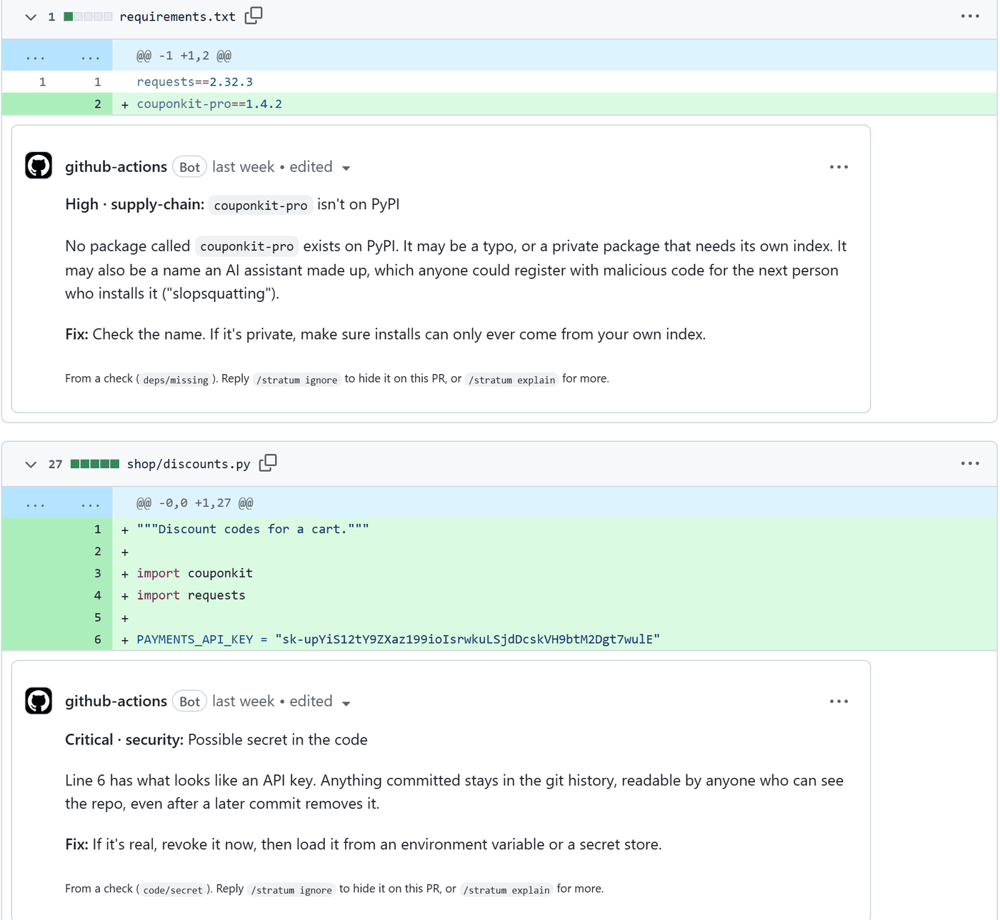

<h1 align="center">Stratum Open</h1>

<p align="center">
  PR review and triage for open-source maintainers, on GitHub's free runner.<br>
  No API key, no account, and nothing is sent to Stratum.
</p>

<p align="center">
  <a href="https://github.com/stratum-org/stratum-open/actions/workflows/tests.yml"></a>
  <a href="https://pypi.org/project/stratum-open/"></a>
  
  <a href="LICENSE"></a>
  
</p>



<sub>Two of the checks' comments on [a demo PR](https://github.com/stratum-org/stratum-demo/pull/2/files).</sub>

Maintainers now get pull requests faster than they can read them, many of
them generated. Stratum Open reads each PR first and sorts the queue, so you
spend your review time on the ones worth it. It runs on open models of 7 to
20B parameters on hardware you control, GitHub's own runner included, and
your rules live in a file in your own repo. No telemetry, no license check.

- **It finds bugs, and it shows its numbers.** Of 39 real PRs, each with one bug planted, the example workflow found 16 on GitHub's free runner, and 27 with [two more settings](#a-more-thorough-review) that make it slower. Every figure is on the [results page](benchmark/RESULTS.md), with its 95% interval and the comments made on the same PRs without the bug.
- **Checks that need no model** catch secrets, risky workflow changes, and packages that don't exist: a typo, or a name an AI invented that someone could register. Together they caught 98 of 99 planted risks, with no false alarms on 184 merged Python PRs.
- **One triage label per PR**, with its reasons, and a queue of every open PR, cheapest to review first.

## Quick start: the GitHub Action

Copy [examples/stratum.yml](examples/stratum.yml) to `.github/workflows/stratum.yml`. That's all.

That workflow runs `gpt-oss:20b` with Ollama on GitHub's own runner, so you need no server. On the [planted-bug benchmark](benchmark/README.md) it found 16 of 39 bugs, against 1 of 39 for `qwen2.5-coder:7b` ([Models](#models) has the numbers). GitHub's free runners have no GPU, though, so a review takes a few minutes: about 3.5 minutes a PR, plus a couple more to download the model. At 13.8 GB it's bigger than a repository's 10 GB Actions cache, so it's downloaded each run; Ollama itself goes into the cache on the first scheduled (or manual) run, and PR runs read it, since GitHub doesn't let them write caches. For the fastest run, set `ollama-model: qwen2.5-coder:7b`, which stays in the cache, though it finds far less. If your project has a machine with a GPU, run Ollama (or any OpenAI-compatible server) there instead. Then point `review.endpoint` in your policy file at it, and drop `ollama-model` from the workflow.

To hear from Stratum sooner, set `review.early_checks: true` in your policy file. The Action then runs the checks before it starts the model and posts what they found straight away: on the lines, in the summary comment (with a line saying the model's review is still running), and as a check run in progress. That's usually within a minute of the job starting, since the checks need no model. When the model is done, the same comment becomes the full review and the check run gets its result. The end result is the same as without the setting. A check's early comment that the full review wouldn't have posted is deleted then: when the model reported the same problem on the same lines, or when `review.max_inline_comments` gives its place to a more serious finding. One that someone has replied to stays. If the model's review never finishes (Ollama doesn't start, or the job fails, times out or is cancelled), the summary says so, and the check run is completed with what the checks found.

The workflow uses `pull_request_target` so it can comment on PRs from forks. It's safe here because the workflow checks out your default branch, never the PR, and Stratum reads the PR only through GitHub's API: no code from the PR ever runs. Keep it that way: don't add a step that checks out the PR, unless you opt in to the [checks that build it](#go-vet-and-clippy-checks-that-build-the-pr), whose setup refuses forks and bots.

### actionlint on the runner

`checks.actionlint` needs `actionlint`, which GitHub's runners don't have. Without it the check is skipped and says nothing. To add it, put this step before Stratum's in your workflow. It installs the release the check was measured with, and stops if the download isn't that file:

```yaml
      - name: Install actionlint
        run: |
          mkdir -p "$RUNNER_TEMP/actionlint"
          curl -fsSL -o "$RUNNER_TEMP/actionlint.tar.gz" https://github.com/rhysd/actionlint/releases/download/v1.7.12/actionlint_1.7.12_linux_amd64.tar.gz
          echo "8aca8db96f1b94770f1b0d72b6dddcb1ebb8123cb3712530b08cc387b349a3d8  $RUNNER_TEMP/actionlint.tar.gz" | sha256sum -c -
          tar -xzf "$RUNNER_TEMP/actionlint.tar.gz" -C "$RUNNER_TEMP/actionlint" actionlint
          echo "$RUNNER_TEMP/actionlint" >> "$GITHUB_PATH"
```

### go vet and Clippy: checks that build the PR

`checks.go_vet` and `checks.clippy` (both off by default) compile the PR's code, so they need a checkout of the PR on disk, and **compiling code runs it**: `cargo clippy` runs build scripts and procedural macros, and obeys a `.cargo/config.toml` that names a program to run in rustc's place; `go vet` runs cgo, and so the C compiler, and downloads the modules `go.mod` names. In a `pull_request_target` workflow that would hand a fork's code a token that can write to your repository.

So they're safe by default:
- With `stratum-open review --local` they run on your checkout, and say on stderr that they're about to build it, since that runs its code: don't run it on a branch checked out from a PR you don't trust. They need a clean checkout: if any change isn't committed, new files included, they don't run, since the review reads HEAD and a build reads more than the changed files.
- The Action never checks out the PR, so they don't run there, and the summary says so, unless the workflow checks the PR out in a folder of its own and passes it as `head-checkout`. Even then, Stratum doesn't build a PR whose branch isn't in your repository (one from a fork), a PR a bot opened, or a checkout that isn't at the PR's head. A PR from a branch of your own repository was pushed by someone who can already run code in its workflows. A bot's PR (Dependabot, Renovate) is different: it brings in a new release of a dependency, and building it runs that release's build scripts. Your CI runs those PRs under `pull_request`, with a read-only token and no secrets, while Stratum's job holds a token that can write and the model's key. So bots' PRs aren't built unless your policy sets `checks.build_bot_prs: true`. The check looks at who opened the PR, not at who pushed its latest commit, and an author GitHub doesn't plainly call a person counts as a bot. Whatever runs, a build never gets Stratum's own variables (`STRATUM_*`, so its token and the model's key), `GITHUB_TOKEN`, `ACTIONS_*`, `INPUT_*`, or the files that set variables and PATH for later steps (`GITHUB_ENV`, `GITHUB_PATH`, `GITHUB_OUTPUT`) in its environment, though code running as the job's user can still find them elsewhere.
- The GitHub App has no checkout, so they never run there.

A build that fails, a run past its time limit (5 minutes for go vet, 10 for Clippy) and a missing tool are each a line in the review's coverage, never a finding. A run past its limit is stopped along with everything it started. To opt in, for PRs from your own branches only:

```yaml
      # Next to the example workflow's checkout of the default branch, which stays as it is.
      - uses: actions/checkout@3d3c42e5aac5ba805825da76410c181273ba90b1 # v7.0.1
        if: github.event.pull_request.head.repo.full_name == github.repository && github.event.pull_request.user.type != 'Bot'
        with:
          ref: ${{ github.event.pull_request.head.sha }}
          path: pr-head
          persist-credentials: false
      - uses: stratum-org/stratum-open@main  # `head-checkout` comes after 0.3.0
        with:
          head-checkout: ${{ github.event.pull_request.head.repo.full_name == github.repository && github.event.pull_request.user.type != 'Bot' && 'pr-head' || '' }}
```

GitHub's Ubuntu runners come with Go, and with Rust and Clippy. If your `go.mod` or `rust-toolchain.toml` asks for a newer version, Go or rustup downloads it, which counts towards the time limit. `staticcheck` you install yourself (`go install honnef.co/go/tools/cmd/staticcheck@latest`); once it's on PATH, go vet adds its SA checks.

## What it does on each PR

- **Checks that need no model** catch what's risky whoever wrote it:
  - secrets in code, `eval`, shell commands and SQL built from strings, and CORS opened to everyone;
  - workflow changes that hand out a write token: `pull_request_target`, write permissions, unpinned third-party actions, and `${{ github.event... }}` inside `run:`;
  - new dependencies, packages published days ago, packages that don't exist (a typo, or a name an AI invented that someone could register), look-alike names such as `reqeusts`, and, when your policy turns it on, a dependency pinned to a version with published security advisories in the [OSV](https://osv.dev) database;
  - edits to files that steer coding agents (`AGENTS.md`, `.cursorrules`, `.github/copilot-instructions.md`…), and hidden Unicode in any added line;
  - imports that break your module rules;
  - in Python, when your policy sets `checks.unknown_names: true`, an import or a call of a name its module doesn't define: `from app.utils import normalize_path` when `utils.py` has no such function, or `os.path.makedirs`. It reads your own modules and 47 of the standard library's, and says nothing where it can't be sure;
  - when your policy turns it on (`checks.weakened_tests`), tests a PR weakens, on the line: a test switched off with nothing to decide when (`@pytest.mark.skip`, `it.skip`, `t.Skip()`, `#[ignore]`, a stray `.only`), assertions removed with nothing in their place, and an assertion's tolerance made wider. On [782 merged PRs](benchmark/results/2026-11-13-weakened-tests/summary.md) it reported 15 removed assertions, none misread, 11 of them plainly fine because the PR said why; the skip and tolerance rules found nothing there, and are proven on planted cases only;
  - in Python, when your policy sets `checks.removed_names: true`, a function, class or constant the PR removes or renames while another file still imports or uses it: `parse_cookie` becomes `parse_cookies` in `http.py`, and `request.py`, which the PR doesn't touch, still has `from app.http import parse_cookie`. The comment goes on the changed module and names the lines that will fail. It follows imports and module attributes only, and says nothing where it can't be sure. [Measured](benchmark/results/2026-11-13-removed-names/summary.md) on 17 projects: nothing on 184 merged PRs or on 5,100 commits as they were merged, and, with each commit cut down to the one file that lost a name, 144 of the 320 removed definitions the commit also took out of another file, and every line it named was one that commit changed;
  - in Python, a coroutine called without `await` inside an `async def`, when the same call is awaited elsewhere in the file, and `await` on a method of a plain file from `open()`;
  - in JavaScript and TypeScript, when your policy turns it on (`checks.floating_promises`) and the `js` extra is installed, a call left unawaited as a statement of its own in an `async` function, when the file awaits the same call elsewhere or declares it `async`. It caught a third of the awaits dropped from merged PRs and said nothing on the 60 PRs as merged ([how it was measured](benchmark/results/2026-11-13-floating-promises/summary.md));
  - Python security issues via Bandit, when it's installed;
  - Python errors Ruff can see without running the code (a name nothing defines, a format string that doesn't fit its arguments, `return` outside a function), when it's installed and your policy sets `checks.ruff: true`;
  - in shell scripts, when your policy sets `checks.shellcheck: true` and `shellcheck` is on PATH (GitHub's Ubuntu runners have it), ShellCheck's errors (`x = 1`, `[ $n > 3 ]`, `local` outside a function) and four of its warnings that name a real bug, such as `cmd 2>&1 >log`, on the lines a PR adds. On [65 merged PRs](benchmark/results/2026-11-14-shell-checks/summary.md) that change a script it reported nothing, and on the 23,997 lines of those scripts read as if new, one false alarm, so what it catches is proven on planted cases only. Scripts over 100,000 characters (acme.sh, nvm.sh) aren't read, since ShellCheck can take a minute on one;
  - in Go, when your policy sets `checks.go_vet: true` and there's a checkout of the PR to build ([where that is](#go-vet-and-clippy-checks-that-build-the-pr)), what `go vet` reports on the lines a PR adds (a `Printf` whose arguments don't fit, a cancel func that's never called, a lock copied by value, unreachable code), and staticcheck's SA checks when it's installed. Not yet measured on merged PRs;
  - in Rust, when your policy sets `checks.clippy: true`, with a checkout to build the same way, Clippy's `correctness` lints on the lines a PR adds (`a == a`, an index past the end of an array, `vec.resize(0, x)`), never its style ones. Not yet measured on merged PRs;
  - in GitHub workflows, when your policy sets `checks.actionlint: true` and `actionlint` is on PATH, which GitHub's runners don't have ([how to add it](#actionlint-on-the-runner)), what actionlint finds on the lines a PR adds: a `needs:` naming no job, a key GitHub doesn't know, a matrix key that isn't there. On [129 merged PRs](benchmark/results/2026-11-14-shell-checks/summary.md) that change a workflow it reported nothing. On the 24,353 lines of those workflows read as if new it made 21 findings: 9 right but harmless, and 11 false alarms, each something GitHub added after the actionlint release it ran with.
- **A review by the model:**
  - a summary of what the PR does, and whether that matches its description;
  - inline comments on the exact lines, with a suggested fix you can commit from GitHub;
  - each push reviews only what changed, and a finding stays until its code changes.
- **Context from the history:**
  - files that a lot of the code imports;
  - code that only one person has changed lately;
  - hotspots that change often and are complex, or keep needing reverts and hotfixes, which get a stricter review;
  - who owns the changed files, from CODEOWNERS.
- **One triage label:** `ready`, `needs work`, `low effort` or `needs a maintainer`, with the reasons spelled out. It judges what's in front of it: CI, tests, a linked issue, size, and whether the change matches its description. CI that GitHub holds until a maintainer approves the workflows, as on a first-time contributor's PR, is never a pass: the PR gets `needs a maintainer`, or `needs work` or `low effort` if the author has something to fix. GitHub doesn't say which PR a fork's finished CI run belongs to, so that label stays until the next push or `/stratum review`. It doesn't try to guess whether AI wrote the PR, because detectors for that aren't reliable. Labels are off until your policy turns them on, and it closes nothing unless your policy says so.
- **A check run** that fails on a critical finding and is neutral on a high one. Make it required in branch protection if you want it to block merging.
- **A triage queue:** one issue listing every open PR, cheapest to review and best supported first. The example workflow rebuilds it once a day, and from the release after 0.3.0 also after each review or label-changing command, and when a PR closes or turns back into a draft ([Upgrading from 0.3.0](#upgrading-from-030)). A rebuild needs no model. From the release after 0.3.0 it reads the open PRs and their comments in one GraphQL query per 50 PRs, which GitHub [counts as 1 point](https://docs.github.com/en/graphql/overview/rate-limits-and-query-limits-for-the-graphql-api) of the 1,000 an hour that `GITHUB_TOKEN` gets for GraphQL: 2 points for 100 open PRs, plus 1 for each further 100 comments on a PR with more than 100. If GitHub gives up on 50 PRs within its 10-second limit on a query, the rebuild asks for 10 at a time instead. Its only REST calls, out of the token's separate 1,000 an hour that the reviews share, are the issue list (one call per 100 open issues and PRs, until it finds the queue issue) and the edit. 0.3.0 makes one REST call per open PR instead. After an event it waits a minute, and a newer event cancels it while it waits, so a burst costs one rebuild. `triage.queue: false` stops rebuilding it, and `stratum-open triage --post` then refuses to post it; close the issue yourself. The GitHub App doesn't keep one yet ([#197](https://github.com/stratum-org/stratum-open/issues/197)).
- **Track records:** each author's merged PRs that were later reverted or fixed, read from git history. Every contributor can see their own, with `/stratum record`. A record affects nothing unless your policy says so.

## Your rules: `.stratum/policy.yml`

Every key, with its default, is in [policy.example.yml](policy.example.yml).

- The policy is read from your **default branch**, never from the PR. A PR that edits it is judged by the rules already merged.
- No file means the defaults. A broken file falls back to the defaults and says why in the review.
- Things you'll likely want to set:
  - `triage.enabled: true` turns the labels on;
  - `review.rules` holds your project's own review rules, in plain words;
  - `review.min_severity` sets how serious a model finding must be to be shown (default `medium`; the checks' findings always show);
  - `review.quiet: true` posts less of what the model says, and keeps it apart from what the checks found;
  - `review.learn_from_history: true` leaves out findings like ones your maintainers rejected on recent PRs (see [Commands](#commands));
  - `review.early_checks: true` has the Action post the checks' findings before the model runs, then complete them into the full review;
  - `always_human.paths` lists paths that always need a maintainer;
  - `boundaries` holds module rules such as `api -> db`;
  - `track_record.affects_triage` lets an author's record move their PR's label.
- `services` is used by hosted Stratum's service map (which service calls, uses, publishes to or consumes from which); Stratum Open ignores it, so the same file works for both. The example file shows it commented out.

## Commands

Comment on a PR, with the command at the start of a line. One inside a code block (between ``` lines) is shown, not run.

| Command | Who | What it does |
| --- | --- | --- |
| `/stratum review` | write access | Review the whole PR again |
| `/stratum ignore` | write access | As a reply to an inline comment: hide that finding on this PR |
| `/stratum ignore <rule>` | write access | Hide a rule on this PR |
| `/stratum ignore <fingerprint>` | write access | Hide the finding with that fingerprint on this PR, as the reply does |
| `/stratum mute <rule>` / `unmute` | write access | Hide a rule on every PR (GitHub App only, since it stores it) |
| `/stratum explain` | the PR's author or write access, a few a day | As a reply to an inline comment: explain that finding in more detail |
| `/stratum explain <fingerprint>` | the same people, sharing the same limit | Explain the finding with that fingerprint, as a comment on the PR |
| `/stratum ask <question>` | the same people as `explain`, sharing its daily limit | Answer a question about the PR from its diff and review; as a reply to an inline comment, about that comment and its code |
| `/stratum triage` | anyone | Why the PR got its label |
| `/stratum record` | anyone | Your own track record in this repo |

**On a PR from a fork, with the Action, reply commands don't run.** GitHub runs a reply in an inline thread with a read-only token on a PR from a fork, and the workflow's `permissions:` can't change that. So there, each inline comment names its finding's fingerprint, and you comment `/stratum ignore <fingerprint>` or `/stratum explain <fingerprint>` on the PR instead: a comment on the PR runs with the workflow's token. A reply there fails the job with a line saying what to post instead. The GitHub App reads replies on every PR.

Commands used to be written `@stratum review`. They aren't read any more: `stratum` is an unrelated GitHub organization, and GitHub turned each one into a mention of it.

**Rejected comments stay rejected.** With `review.learn_from_history: true`, each review first reads the repo's latest 100 inline comments and 100 PR comments from GitHub (`review.learn_lookback` sets how many), and leaves out findings like ones people with write access rejected there. A 👎 on one of Stratum's inline comments, a `/stratum ignore` reply to it (or `/stratum ignore <fingerprint>` on its PR), or `/stratum ignore <rule>` on a PR counts against it; a 👍 counts for it.
- A rule is muted once it has 5 or more such votes and at least 60% of them are against it, as in the GitHub App. That goes for every finding of the rule, the checks' included, whatever its severity.
- A model finding is also left out when maintainers voted against that same finding (same kind of problem, same file, same code) more than for it, on this PR or another.
- The summary says what was left out and where it was rejected (for example "Hidden: 2 comments like ones maintainers rejected on #123 and #130"), and the comment threads of findings left out are closed with that reason.
- Nothing is stored: it costs at most 32 API calls a review with the default look-back (2 pages of comments, the reactions on up to 20 comments, and the access of up to 10 people). If GitHub refuses a read, such as at a rate limit, the review goes on and hides less, or nothing, and says why.
- GitHub sends no event for a reaction, so a 👎 takes effect on the next push.
- Only votes still among those latest comments count, so on a busy repo a muted rule can come back once its votes are older than that; a larger `review.learn_lookback` keeps them longer.

## GitLab

Experimental: Stratum reviews merge requests from a GitLab CI job, on gitlab.com or a self-hosted GitLab. It has been tested against a faked GitLab API, not a live GitLab yet, so please open an issue for anything that breaks.

To set it up:

1. Create a project access token with the Developer role and the `api` scope, and add it as a masked, hidden CI/CD variable named `STRATUM_GITLAB_TOKEN`. The job token can't post MR notes.
2. Add the job in [examples/gitlab-ci.yml](examples/gitlab-ci.yml) to your `.gitlab-ci.yml`. It runs `qwen2.5-coder:7b` with Ollama in the job and runs `stratum-open gitlab`.

It posts a summary note that's updated on each pipeline, threads on the lines with suggestions you can apply, resolves a thread when its code changes, and sets a commit status (and a triage label, when your policy turns labels on). The API URL comes from `CI_API_V4_URL`, so a self-hosted GitLab needs nothing more.

The job checks out nothing of the MR and reads it only through the API, and the rules come from your default branch, as on GitHub. One thing is different, and you should know it before you turn it on: an MR's pipeline runs the `.gitlab-ci.yml` of the MR's own branch, so anyone who can push a branch to the project can change the job and read the token. Keep the token's role at Developer, and give it an expiry. MRs from forks run in the fork and get no token, so nothing is posted until a maintainer runs the pipeline in the project. Comment commands aren't read on GitLab yet; resolving a thread hides its finding on that MR. [docs/gitlab.md](docs/gitlab.md) has the details, what else differs, and what has been tested (a faked GitLab API, not a live one yet).

Gitea and Forgejo aren't supported yet; [docs/gitea-forgejo.md](docs/gitea-forgejo.md) has what it would take.

## Other ways to run it

**GitHub App.** One container on your server, for projects that would rather install an App than add a workflow to every repo.
- It's the only mode that stores anything: findings for 180 days, 👍/👎 votes from people with write access (which mute rules your maintainers keep rejecting), and a 14-day job log. Uninstalling deletes a repo's rows at once. The Action gets the same muting from GitHub itself with `review.learn_from_history`.
- **Create the App:**
  - Permissions: contents and actions read; pull requests, issues and checks read & write. Actions read lets it see CI that waits for a maintainer's approval on a private repo.
  - Events: pull request, issue comment, pull request review comment.
- **Run it:** `docker build -t stratum-open .` and run it with `STRATUM_APP_ID`, `STRATUM_APP_PRIVATE_KEY_FILE`, `STRATUM_WEBHOOK_SECRET` and `STRATUM_MODEL_ENDPOINT` set (see the [Dockerfile](Dockerfile)). Point the App's webhook at `https://your-host/webhook`.

**CLI.** `pip install stratum-open` for:
- `stratum-open review --local main`: review your branch against `main` before you open a PR. Handy for contributors too.
- `stratum-open review owner/repo#123`: a dry run on any PR; `--post` publishes it.
- `stratum-open record <login>`: a record from a local clone's history.
- `stratum-open policy check`: validate a policy file.
- `stratum-open replay owner/repo`: the label each of your last 50 closed PRs would have got, beside whether it was merged. No model, and nothing is posted.
- `stratum-open triage owner/repo`: the sorted queue.
- `stratum-open data …`: see or delete what the App stored.

## Models

The target is a 7–20B open model. Defaults:
- `gpt-oss:20b` in the example workflow, on GitHub's runner;
- `qwen2.5-coder:7b` through Ollama when neither the workflow nor `review.model_name` names a model, since `gpt-oss:20b` needs 16 GB of RAM;
- any OpenAI-compatible server works;
- a hosted model works too, if your project prefers one (`review.model: hosted`, with the key in `STRATUM_MODEL_API_KEY`).

On GitHub's free runner (4 CPUs, 16 GB RAM, no GPU) you can choose between two models. The numbers are from the [planted-bug benchmark](benchmark/README.md): 39 real PRs, each with one bug planted. Every number, with its sample size and 95% interval, is on the [results page](benchmark/RESULTS.md).

| `ollama-model` | Policy setting | Bugs found | Wrong comments per clean PR | Time per PR | Download |
| --- | --- | --- | --- | --- | --- |
| `qwen2.5-coder:7b` | | 1 of 39 | about 0.4 | about 2.5 min | 4.7 GB, kept in the Actions cache |
| `gpt-oss:20b` (the example's) | `review.reasoning: low` and `review.verify: strict`, set for it automatically | 16 of 39 (12 to 18 over four runs) | about 0.2 | about 3.5 min | 13.8 GB, downloaded each run |

`gpt-oss:20b` finds far more, at about the same speed and with fewer wrong comments. With the logic pass and ten lines of code around each change it finds more again, for about three times the wait ([a more thorough review](#a-more-thorough-review)). Two costs of `gpt-oss:20b` either way:
- **Disk:** it doesn't fit the runner's disk as it comes, so the Action removes preinstalled SDKs it doesn't need to make room.
- **Cache:** it's bigger than a repository's 10 GB Actions cache, so it's downloaded each run, which adds a couple of minutes. Ollama itself is still cached.

Stratum sets two things for `gpt-oss` itself, so to switch models you only change `ollama-model`:
- `review.reasoning: low`: it's a thinking model, and without it the thinking uses up the output budget and most replies come back empty;
- `review.verify: strict`: it costs `gpt-oss` no real catches and halves its wrong comments. On the 7B, by contrast, it removes noise only because there were no real catches to lose.

Your policy file's own value for either wins, and each review's summary says which were set for the model.

The same review can catch different bugs from one run to the next, so expect the counts to move by a few.

### A more thorough review

If you'd rather wait longer for more catches, turn on the logic pass and show the model ten lines of code around each change. In `.stratum/policy.yml`, with `ollama-model: gpt-oss:20b`:

```yaml
review:
  logic_pass: true      # one more call per chunk, for logic errors only
  context_lines: 10     # unchanged lines shown around each change
```

On the planted-bug benchmark this found 27 of 39 bugs, against 18 for the same model without the two settings, including inverted `return`s and off-by-ones the plain review never caught. What it costs:

- **Time:** a review takes about three times as long, a median of about 11 minutes a PR on the free runner, and a large PR can take most of an hour.
- **Comments on code with nothing wrong:** about 0.4 a PR, against 0.2.

The two settings only help together: each on its own found one or two more. Neither is on by default, because of the wait. [How it was measured](benchmark/results/2026-11-13-logic-pass-actions-cpu/notes.md).

How much a review asks of the model depends on the model. `review.profile: auto` asks the model's server for its size:
- **`small`**, for models up to about 20B: a compact diff, 1–3 model calls.
- **`large`**, for bigger ones: the new and old code shown apart, a bigger context window, and Bandit's low-severity results too. It also reviews the 15 most important files one at a time, the top 5 of them again for security, performance and logic, and writes a walkthrough. That's up to about 29 model calls a PR, 4 at a time, instead of 1–3, so check the cost on a paid API. Set `review.file_reviews: 0` to keep the rest of `large` without them.

A profile only fills in settings your policy file doesn't set, so anything you set stays as you set it. Each review says which profile it used and why. `review.mode` (`general`, `security`, `performance` or `maintainability`) sets what the per-file passes look for first.

Small models make more mistakes than large ones, so Stratum checks their answers:
- a finding goes on the line whose code the model quoted, not the line number it guessed;
- a suggested fix is offered only where the model showed which lines it replaces;
- anything outside the diff is dropped;
- a finding that only describes the change ("New function") is dropped, and one vague worry repeated down a file becomes one finding.

The [benchmark](benchmark/) reviews real merged PRs with each model, and maintainers mark each finding right or wrong. Its results are published in `benchmark/results/` as each run finishes.

## Data

[DATA.md](DATA.md) lists every field stored, where it lives and for how long, and everything that leaves your infrastructure. A test fails when a stored field is added without a line there.

## Upgrading from 0.3.0

The release after 0.3.0 rebuilds the triage queue issue after each PR's review, after `/stratum review` and `/stratum ignore`, after a CI re-sort, and when a PR closes or turns back into a draft, not only in the daily run, which GitHub often starts hours late. If you copied [examples/stratum.yml](examples/stratum.yml), copy four changes from it:

- `closed` and `converted_to_draft` in the `pull_request_target` types;
- the `stratum` job's `if:` filter, which starts no review for those two: replace `github.event_name == 'pull_request_target' ||` with `(github.event_name == 'pull_request_target' && github.event.action != 'closed' && github.event.action != 'converted_to_draft') ||`;
- the `queue` job, named `Stratum triage queue` and pinned to the same release or commit as the review job. It runs `stratum-org/stratum-open/queue`, which starts no model, after the review job. Each rebuild costs a few API calls ([the triage queue](#what-it-does-on-each-pr) says how many), and after an event it waits a minute first, and a newer rebuild cancels it, so a burst of events costs one rebuild. A comment starts it only after the review job ran a command, and only `/stratum review` and `/stratum ignore` on a PR rebuild, from someone `commands.review` or `commands.ignore` lets run them; a CI result rebuilds only when it re-sorted a PR. Keep its name: Stratum leaves check runs by that name out of a PR's CI, and a cancelled one would otherwise read as failing CI;
- `triage-queue: false` on the review job's Stratum step, so the daily and manual runs leave the rebuild to the `queue` job and no two rebuilds overlap. The `stratum` job still runs on them, since its scheduled run is what keeps Ollama in the Actions cache.

The first two work on 0.3.0 and are in the example already. The `queue` job and `triage-queue: false` are commented out there until the release that has the `queue` action, since `stratum-org/stratum-open/queue@v0.3.0` doesn't exist. Uncomment them together when you pin that release: `triage-queue: false` without the job stops the daily rebuild. Without either, the daily run rebuilds the queue as before.

Two more changes in that release:

- **`actions: read`.** On a private repo, the workflow needs `actions: read` in its `permissions:` block (the example has it), and an existing GitHub App install has to accept the new "Actions: read" permission. Without it, CI that's waiting for a maintainer's approval reads as passing again, and the only sign is a line in the job's log.
- **`replay --json`'s `ci` field** is now a string (`"passed"`, `"failed"`, `"pending"`, `"held"` or `"none"`), not `true`/`false`/`null`.

## Upgrading to 0.3.0

The command is now `stratum-open`, or `python -m stratum_open`; it was `stratum`. Hosted Stratum's client also installs a `stratum` command, and the new name lets the two sit side by side. Change any script, cron job or container command that runs `stratum`, such as `stratum serve` or `stratum data purge`. Nothing else is renamed: the Action, `.stratum/policy.yml` and the `STRATUM_*` settings work as before.

Comment commands are now written `/stratum review`, `/stratum ignore` and so on (see [Commands](#commands)); `@stratum review` no longer does anything. If you copied [examples/stratum.yml](examples/stratum.yml), update its job's `if:` filter, or `/stratum` comments won't start the job: replace `contains(github.event.comment.body, '@stratum')` with `contains(github.event.comment.body, '/stratum ')`. The GitHub App needs no change. Inline comments from 0.2 say "Reply `@stratum ignore`"; the next review of the PR rewrites that hint as `/stratum ignore`.

If your code embeds the engine (`stratum_open.analyze`): a file that moves to where a check does more (out of `tests/`, into `.github/workflows/`, or to a manifest's or an `action.yml`'s path) is now checked in full, since every line of it is new where it now is. Three things follow:

- **Pass those files' text in `contents`.** `stratum_open.moved_in(file)` says which files they are. A moved file without its text gets one `checks/moved-unread` finding naming it, since the checks could read only the lines the diff marks as added.
- **Leave out the binary ones.** A move with no edits looks the same in a diff whether the file is text or not. When `stratum_open.looks_binary(text)` is true, don't pass the text; set `file.binary = True` instead. Text from an image or an archive passed in `contents` can match the secret rules.
- **Post inline only what can take a comment.** A check's finding can now have a line the diff doesn't show, and GitHub refuses an inline comment there. Post inline only the findings `stratum_open.placeable(findings, files)` returns, and list the rest in the summary.

## Stratum Open and hosted Stratum

Stratum Open is the engine and the ways to run it yourself. Hosted Stratum runs the same engine as a service, with managed models and features that need a database (incidents, Drift, Insights). [How Stratum and Stratum Open fit together](docs/stratum-and-stratum-open.md) explains which does what, the commands in each, and which repository owns what.

## Status

Early. It works end to end on GitHub. Expect rough edges, and please open issues.

## License

[GNU AGPL-3.0](LICENSE). Contributions are under the [CLA](CLA.md), which a bot asks you to sign on your first PR. See [CONTRIBUTING.md](CONTRIBUTING.md).

Copyright © 2026 Anshul Patil.
